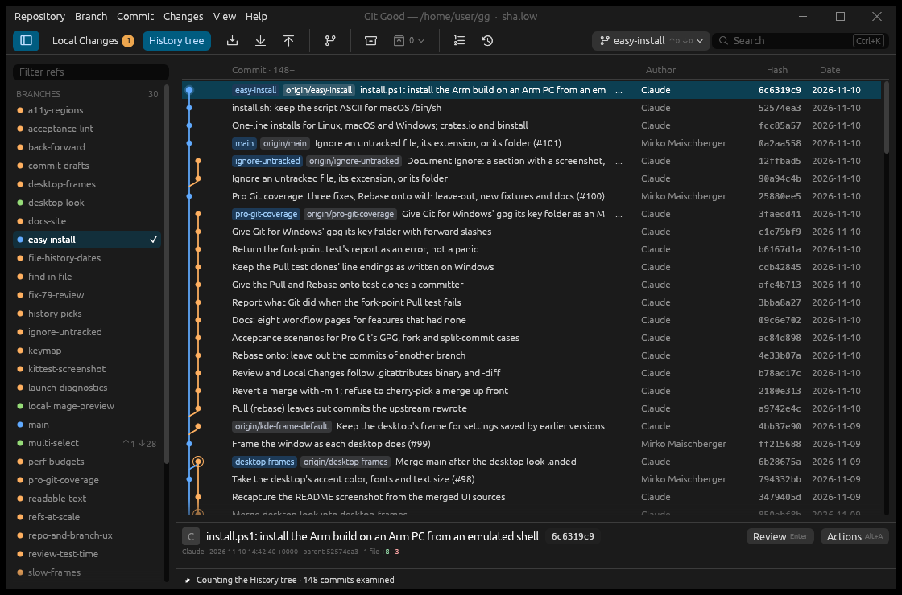
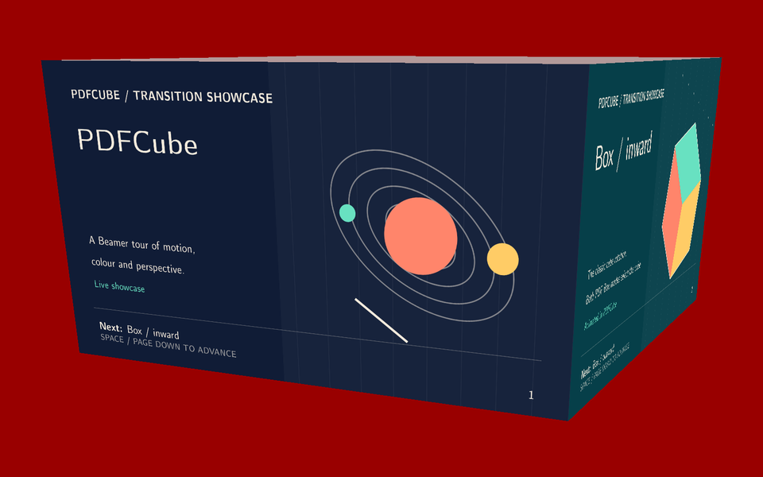
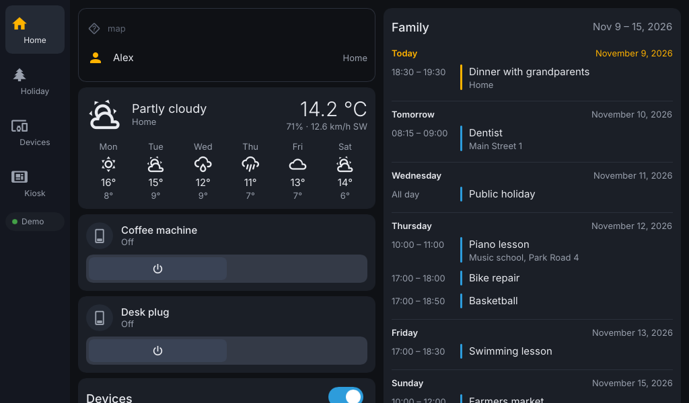
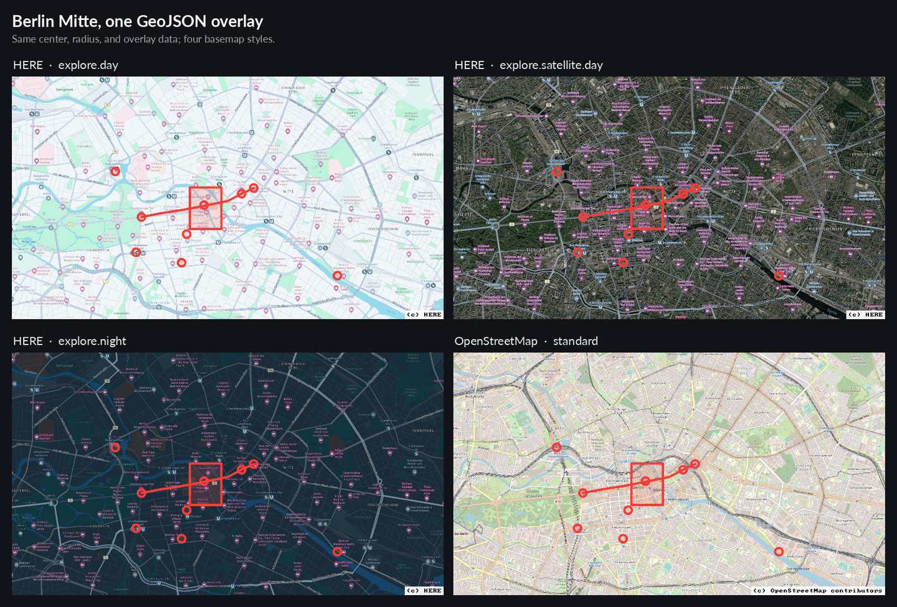
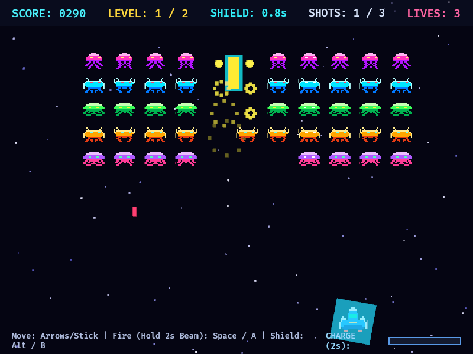

# Hi, I'm Mirko

*Complex software needs no complicated solutions.*
{ .tagline }

I'm a software developer interested in free software, complex algorithms,
operations research and security. I co-founded the LILiK free software lab in
Florence, Italy, but that happened in the previous millennium.

## Work

At [HERE](https://www.here.com) I'm an Engineering Manager in Path Matching and
Sensor Data Processing, responsible for the
[Location Library](https://docs.here.com/workspace/docs/ll_docs_high-level-v2)
and the
[Platform Tutorials](https://docs.here.com/workspace/docs/tutorials_tutorials).

## Research

My papers are on
[Google Scholar](https://scholar.google.de/citations?user=rc-liiQAAAAJ&hl=en).
I wrote [METSlib](https://github.com/coin-or/metslib), a C++ framework for big
combinatorial optimization problems, and used it in a paper on vehicle routing.
It also powered the Routist fleet optimization engine at KKT, the startup I
founded.

## Projects

-   

    [**Git Good**](https://100allora.it/gg/): a fast, native Git desktop app.
    Browse the history tree, stage hunks or lines, rebase and recover
    rewrites.

-   

    [**PDFCube**](pdfcube/index.md): a PDF presentation viewer with cube
    rotations, page flips and shattering glass, loved by LaTeX Beamer users
    since 2006.

-   

    [**hada**](https://github.com/baol/hada-kiosk): native Home Assistant
    dashboards for wall panels and kiosks. No browser, one binary.

-   

    [**mapshoot**](https://github.com/baol/mapshoot): headless, fast
    screenshots of GeoJSON data on a basemap.

-   

    [**Alien Attack**](https://100allora.it/alien-attack/): an arcade shooter
    in Rust and Bevy, designed with my kids. Plays in the browser.

Also in progress: **mets** (not public yet), neighborhood-based metaheuristics
in Rust and a port of METSlib: tabu search, simulated annealing, late
acceptance, iterated and memetic searches.

Most recent projects are human specs, AI code.

### Older

- [Waving-z](https://github.com/baol/waving-z): a software radio modulator and
  demodulator for Z-Wave signals.
- [Rose](https://github.com/baol/rose): a tile generator for 3D printing and
  infinite Penrose tilings.
- [Chebyshev](https://github.com/baol/chebyshev): how to approximate any
  function on an interval with Chebyshev polynomials.
- [homely](https://github.com/baol/homely): IoT wiring and notifications over
  MQTT, Unix style.

More on [GitHub](https://github.com/baol).

## Notes

- [Z-Wave traffic monitoring for 10€](texts/A-tale-on-Z-Wave.md) (June 2016)

## Elsewhere

[maischberger.it](https://maischberger.it) is our family recipe book (in
Italian).
